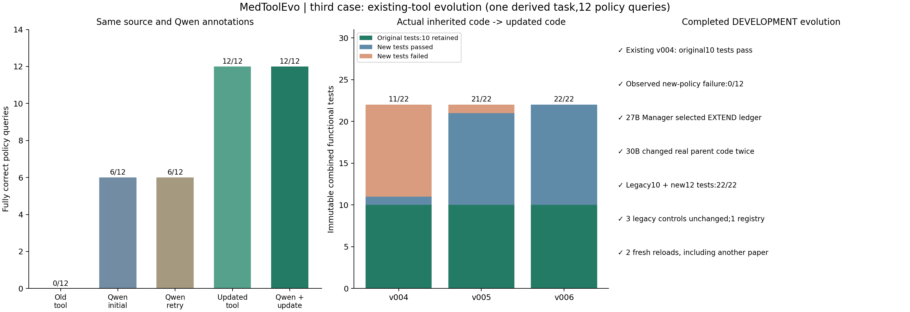

# MedToolEvo：代码与实验审阅包

用于请他人审查工具自进化原型的实现、实验设计、结果归因和未解决问题。这里保留成功与失败记录，**不是已经通过正式医学基准的系统**。

固定模型：**Qwen3.5-27B**负责语义、Executor、Manager等角色；**Qwen3-Coder-30B**负责候选代码生成和修复。权重未训练或替换。任务、数学/逻辑定义、独立参考程序和部分测试由研究者预先设置，具体人工介入见各案例报告。

## 请先看这些文件

1. [审阅指南：优先检查哪些问题](REVIEW_GUIDE.md)
2. [已观察问题与状态](typical_cases_20261109/issues.json)
3. [三个案例覆盖与修复计划](typical_cases_20261109/典型案例与统一修复计划.md)
4. [正式100题实验快照](formal_snapshot/SNAPSHOT.json)与[当时进度](formal_snapshot/progress.json)
5. [无需模型的核验与CPU重放](REPRODUCIBILITY.md)

## 已完成的开发案例

| 案例 | 初始Qwen | 同证据重试 | 工具后Qwen | 实际功能测试 | 完整材料 |
|---|---:|---:|---:|---|---|
| 论文表格加权计算 | 0/4数值 | 0/4 | 4/4 | 首版8/8 | [报告](engineering_case_20261109/本周交付_真实表格工程闭环.md) |
| 正文引文定位和Unicode坐标 | 1/7定位请求 | 1/7 | 7/7 | 经3次代码修复，最终13/13 | [报告](anchor_case_20261109/第二条闭环交付.md) |
| 已有证据台账增加条件查询 | 6/12查询 | 6/12 | 12/12 | 原代码11/22→21/22→22/22，旧10项每版通过 | [报告](policy_case_20261109/第三条_工具自进化交付.md) |

这些分母是单例任务中的数值、定位请求或查询，**不是独立医学问题数，不能相加成总体准确率或BioASQ F1**。三条仅完成开发注册；均未作为正式稳定工具注册结果计入原100题/1130题实验。

## 必须保留的负面结果与限制

- 原文定位案例补充边界检查仅 **2/5**：前缀连续空白会使坐标出错，函数本体未拒绝额外字段。[结果](anchor_case_20261109/posthoc_boundary_audit.json)。开发案例通过不意味着通用工具已可靠。
- 引用索引探索在Manager暂缓处停止；其原0/23主要为ID命名空间表示差异，事后机械审计23/23，不算工具修复。[审计](citation_case_20261109/representation_audit.json)。
- 独立测试期望曾被Qwen错误计算；后续版本改为Qwen设计输入、可信规则程序计算期望，在候选代码前冻结。原错误和版本变化仍保留。
- 正式100题当前快照尚无新构建/稳定注册，详见快照；不能用上述人为构造的工程案例替代正式验收。
- 第三条第一次新进程复用重放的是两个已见查询组成的新批次；第二次才是另一篇论文上的新查询。复用由控制器触发，未证明开放式自主路由。

## 实现入口

- 正式100题：[run_reliable_pilot100.py](repair2_20261109/reliability_v6_1/run_reliable_pilot100.py)
- 失败真实性判断：[failure_authenticity.py](repair2_20261109/reliability_v6_1/failure_authenticity.py)
- 契约与构建：[contract_guard.py](repair2_20261109/reliability_v6_1/contract_guard.py)、[closed_loop_core_v5_1.py](repair2_20261109/reliability_v6_1/closed_loop_core_v5_1.py)
- 数值案例：[engineering_case_pipeline.py](engineering_case_20261109/code/engineering_case_pipeline.py)
- 定位案例最终版本：[anchor_pipeline.py](anchor_case_20261109/code_v3/anchor_pipeline.py)
- 第三条已有工具更新：[policy_pipeline.py](policy_case_20261109/code/policy_pipeline.py)

各案例 `evidence/runs/<run>/code_snapshot/` 是实际运行冻结源码，审查结果时以它与原始请求/响应为准。其余代码目录包含开发、迁移和失败版本；不要混成同一实验结果。

## 数据和文件范围

包含必要源码、候选版本、测试、模型调用记录、源片段、版本继承、验收、图表，以及正式实验已完成题的结果与7个诊断样例。已补充完整BioASQ 14b（5729题）和DocHopQA（11379条）原始JSON、现有派生任务/参考答案及固定100题公开输入。两个原始JSON通过Git LFS保存，下载与校验见[数据集说明](DATASETS.md)。模型权重、密钥、SSH配置、缓存、虚拟环境及重复压缩包未上传。

原始证据中的服务器绝对路径作为来源记录保留；不是可在任意机器直接运行的安装路径。Git关闭自动换行转换，避免改变代码和测试的原始SHA256。第三方文本/数据保留其原始权利与许可，本仓库不为其另行授予许可。
