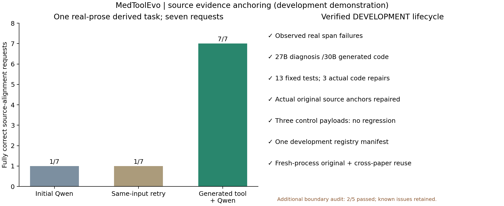

# 第二条完整闭环：真实医学正文的精确证据定位

开发级验收通过，完成时间：北京时间2026-11-09 19:36:23。模型固定Qwen3.5-27B负责语义与管理，Qwen3-Coder-30B负责代码。原文、初始回答、测试和候选代码没有人工改写。

本例从DocHopQA条目9152所附论文PMC11872689的Results正文构造工程任务，原始文本1,424个Unicode字符，7个定位请求，其中6个有源支持、1个为明确不存在的符号探针。源正文逐字保留；问题、查询短语、规范化规则、坐标定义和验收由研究者预先固定。它不是原DocHopQA/BioASQ题，也不是医学答案正确率实验。

来源：[Effects of Vitamin D Supplementation on Blood Pressure in Patients With Type 1 Diabetes Mellitus: A Systematic Review of Clinical Trials](https://pmc.ncbi.nlm.nih.gov/articles/PMC11872689/)，DOI10.1002/hsr2.70524。复用来源为另一篇论文PMC11856201，DocHopQA条目9532。只核查文本定位，不推导这些论文的临床结论。

## 前后结果

| 定位请求 | 原文出现次数 | 初始 | 同证据重试 | 工具后 |
|---|---:|---|---|---|
| studies | 5 | 未通过 | 未通过 | 通过 |
| vitamin D | 2 | 未通过 | 未通过 | 通过 |
| double‐blind | 1 | 未通过 | 未通过 | 通过 |
| hypertension | 1 | 未通过 | 未通过 | 通过 |
| ACEI/ARB medication | 1 | 未通过 | 未通过 | 通过 |
| white European | 1 | 未通过 | 未通过 | 通过 |
| __absent_literal_probe__ | 0 | 通过 | 通过 | 通过 |

一个请求只有在全部出现位置、来源、Unicode字符起止坐标和逐字引文均正确时才通过。坐标相对于每次输入的source.text，从0起计，末端不包含；不是整篇PDF的页码/全局坐标。七个请求不是七道独立医学题。不存在的探针用于检查拒绝能力，不是伪造医学事实。六个正向请求合计11处原文出现。

## 完整流程

- 真实初始失败：1/7，同证据重试1/7；预先固定的规则未因输出而改变。
- Manager诊断缺少可靠的原文字符映射及全部出现位置定位能力，自主决定create；已告知旧quote_locator只能返回首个引文、没有全部坐标/NFKC字符映射，数值统计工具不适用。
- Builder从通用契约生成工具。13个测试由8个Qwen设计的虚构输入和5个预先定义的CPU边界输入组成，期望值由已独立检查的规则程序计算，在首版代码前冻结；后续候选失败仅用真实反馈修复，冻结后的测试不改。
- 真实沙箱调用后，工具结果与离线原文坐标参考逐项一致；27B读取真实输出后7/7，审核通过。
- 三个原文控制输入比较基线与工具输出，无回退。控制未额外运行工具后Executor，不夸大为三条完整问答。
- 开发注册1件，代码SHA256=5e314cfd4f195b5123f2d8bcb79f4391d8da31d544bf22a497df2e7e5603664d。
- 两次新进程重载：原输入，以及另一篇论文的不同输入；均实际运行代码，并经27B整理后通过。复用由控制器触发，不代表自主跨论文工具路由已学会。

## 实际代码修复轨迹

| 代码版本 | 功能通过 | 功能失败 |
|---|---:|---:|
| v001 | 12 | 1 |
| v002 | 12 | 1 |
| v003 | 12 | 1 |
| v004 | 13 | 0 |

实际自动代码修复3次。失败为Unicode全角字符与连续空白折叠后的原始坐标映射错误，v004通过13/13。全部版本及同一测试哈希保留，无人工源码修补。

## 基础设施修订与人工介入

前置v1在契约生成阶段出现非法嵌套Schema及真实输出截断，候选代码尚未生成即保存停止。v2改为控制器附加已固定的Schema，Qwen只编译算法；随后Qwen填写的合成测试期望坐标三轮仍有错误，按规则拒绝，仍无候选代码。v3保留这些Qwen设计输入，并加入原先CPU预检的5个边界例，由独立规则程序计算期望值后冻结13个测试，才交给Coder。

题目、原文、规范化定义、I/O、原任务参考程序、控制与开发准入标准保持一致。v3只复用完整请求指纹一致的原始初答、重试、Manager及算法编译调用，没有重挑更差基线；复用源文件与哈希见reused_observations.json和reused_algorithm.json。旧失败、修订和费用均保留。测试期望值构造方式与13项覆盖是新版本明确记录的协议改动，不把它写成旧v2测试已通过。

## 与上一条区别

| 已完成案例 | 新生成的能力 | 验收单位 |
|---|---|---|
| 论文表格加权计算 | 加权均值、方差等确定性数值处理 | 单题4个数值 |
| 本例：正文证据定位 | Unicode规范化后的全部匹配、原文位置反向映射、无来源拒绝 | 单题7个定位请求 |

前置引用索引探索没有跑通：Manager暂缓构建，已保留原始失败记录。事后只去掉已声明来源的重复前缀，第二份正文的23/23组成员即一致，说明原0/23主要是ID表示差异；该审计不改原评分、不计为工具修复。研究数量与字面引用区间的源内差异也保持未解决。

本次过程的所有失败用于问题归档；不报告“尝试都成功”。两个开发成功案例不能相加成统一F1、正式稳定注册或100题验收。正式100题及1130题仍独立，只有100题完成且验收通过才允许启动全量。

## 扩展边界审计：仍有待统一修复的问题

在冻结案例通过后，源码检查提示坐标映射和额外字段校验可能不完整，因此另用5个固定CPU探针复测，结果2/5通过。两种“连续空白出现在匹配词前”的输入未正确返回位置；函数本体也未拒绝额外顶层字段。正常ASCII和全角字符正向探针通过。带Schema的调用边界会阻止额外字段，但函数本体仍未完全兑现契约。

这份事后检查独立保存于[posthoc_boundary_audit.json](posthoc_boundary_audit.json)，不改旧13项测试及case_acceptance，不作为新的医学结果。当前工具保持开发级，不能据有限验收宣称对任意文本可靠。残余问题进入统一修复清单，下一冻结版本需带着这些反例复测，而不能只重复成功例。

## 原始证据

- [最终验收](evidence/runs/engineering_anchor_case_v3_20261109T113122/case_acceptance.json)
- [原题修复与同证据对照](evidence/runs/engineering_anchor_case_v3_20261109T113122/original_repair.json)
- [Manager诊断](evidence/runs/engineering_anchor_case_v3_20261109T113122/manager.json)
- [独立测试及版本轨迹](evidence/runs/engineering_anchor_case_v3_20261109T113122/builds/candidate/builder_summary.json)
- [实际生成源码](evidence/tools/validated/open_diagnose_unicode_span_misalignment_5e032d1f_v004.py)
- [开发注册](evidence/runs/engineering_anchor_case_v3_20261109T113122/development_registry/diagnose_unicode_span_misalignment.json)
- [重载复用](evidence/runs/engineering_anchor_case_v3_20261109T113122/reuse.json)
- [任务构造、来源和人工介入](evidence/runs/engineering_anchor_case_v3_20261109T113122/task.json)

源正文SHA256：c627aa1ad4eff8518ded0221929b1d360cb84f66c684423bba3df771138fd491。独立原文坐标参考从未发送给初始Executor、Manager、Compiler或Builder；合成测试的离线纠错仅涉及虚构小输入。
