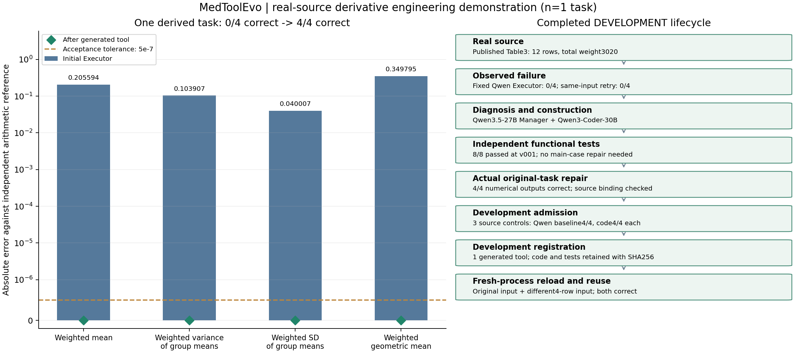

# MedToolEvo 本周工程闭环交付

**结论：按用户明确选定的开发级工程标准，已完整通过一条真实来源派生案例。** 验收完成时间：北京时间2026-11-09 18:03:23，原始报告case_acceptance.json的pass=true。

数据来自[真实论文Table3](https://pmc.ncbi.nlm.nih.gov/articles/PMC11835903/#Tab3)：*Evaluating the impact of the Radiomics Quality Score: a systematic review and meta-analysis*，DOI10.1007/s00330-024-11341-y。使用DocHopQA条目9990附带的原始表格快照，选取System/body location下全部12行，权重合计3020。公开页面元数据已核对，冻结表格及哈希一并提供。

**这是研究者构造的问题，不是DocHopQA原题或BioASQ原题。** 四个输出是对已公布舍入数值的指定数学运算，用来验证工具流程；不作为原论文发现、RQS汇总方法推荐或患者层面的总体估计。4/4表示单个问题的4个数值正确，不是4道独立问题，也不计入BioASQ正式结果。

## 前后指标

| 数值指标 | 初始Executor | 同证据Qwen重试 | 工具后Executor | 独立参考值 |
|---|---:|---:|---:|---:|
| 加权均值 | 9.066327 | 9.066327 | 9.271921 | 9.271921 |
| 组均值的加权总体方差 | 1.634854 | 1.634854 | 1.738761 | 1.738761 |
| 组均值的加权总体标准差 | 1.278614 | 1.278614 | 1.318621 | 1.318621 |
| 加权几何均值 | 8.837862 | 8.837862 | 9.187657 | 9.187657 |

初始0/4，同证据重试0/4，实际使用生成工具后4/4。固定绝对误差门槛为5×10⁻⁷，题目和精度在首次模型作答前固定。离线参考采用Decimal60位计算，并事先与NumPy独立核对；参考结果没有发送给初始Executor、Manager、Compiler或Builder。工具后Executor收到的是实际生成代码的运行输出。

## 流程证据

| 环节 | 实际结果 |
|---|---|
| 源证据 | 原始XML保留，BeautifulSoup与ElementTree两套解析一致，12/12行 |
| 初始失败 | Qwen3.5-27B正常作答，4个数值均未达到门槛；输出未经改写 |
| 缺口诊断 | Qwen3.5-27B选择创建可复用的加权数值计算能力 |
| 工具生成 | Qwen3-Coder-30B从通用规格生成weighted_statistical_summaries |
| 独立测试 | Qwen独立提出合成测试，可信算术预检，8/8通过 |
| 实际调用和原题修复 | 真实沙箱调用，4/4；Qwen审核确认数值修复和源操作数支持 |
| 开发准入 | 3个同源单行控制输入：模型基线逐个4/4，工具输出逐个4/4，数值不退步；未额外运行控制输入的工具后Executor |
| 开发注册 | 1件工具，持久化manifest及代码/测试哈希 |
| 重载复用 | 新进程PID1836435重跑原输入，PID1836441计算另一组4行输入，均通过；固定Qwen读取真实输出后也均4/4 |

主例代码版本v001即通过8/8，**主例代码自动修复次数为0，没有人为制造错误**。自动修复组件另有真实候选复测：初版2/7，经固定Qwen诊断、Qwen3-Coder-30B一次自动代码修复后7/7；同一套独立测试未修改。该记录属于另一个候选的工程恢复复测，不合并成主例的修复次数，也不称为该候选医学问答已通过。

## 模型、人工介入和边界

语义、诊断、契约编译、测试提案、执行结果整理及审核均使用现有固定Qwen3.5-27B部署；候选代码和代码修复使用Qwen3-Coder-30B。未训练或替换权重。

人工预先确定：来源表格和选取段落、派生问题与数学定义、固定数值I/O、精度和独立参考程序、控制输入、复用输入、沙箱和控制器。数据准备是可信解析，源码由Coder生成，未手写或修改候选函数。此前上下文和诊断传输修正发生在此工程运行开始前；主例从首次作答至完成连续自动运行。

复用由控制器触发，验证持久化和新进程调用；不宣称已验证开放式任意工具发明、自主跨论文选工具、临床可靠性或总体统计收益。开发注册为development_registry，不替代正式稳定注册；原100题与1130题门槛保持独立。本例没有通过100题验收，也不授权启动全量。

借鉴论文的重点是明确可执行对象、真实运行反馈、独立准入和持久复用，可参见[MedRSI作者实现](https://github.com/ImprintLab/MedRSI/blob/d453b7047275a62b3dc92020f1c959b384982f61/medrsi/evolve.py)。九篇论文及实现的核对记录见项目repair2_20261109/修复依据与验收_20261109.md；本例不宣称复现论文指标。

## 可核查文件

- [原始数据集逐字来源核查](data_provenance_verification.json)
- [最终验收JSON](evidence/runs/engineering_weighted_case_20261109T095954/case_acceptance.json)
- [原始模型回答和数值评价](evidence/runs/engineering_weighted_case_20261109T095954/baseline.json)
- [原题修复、同证据对照与Qwen审核](evidence/runs/engineering_weighted_case_20261109T095954/original_repair.json)
- [实际生成的工具源码](evidence/tools/validated/open_weighted_statistical_summaries_52f5789e_v001.py)
- [独立测试与版本轨迹](evidence/runs/engineering_weighted_case_20261109T095954/builds/candidate/builder_summary.json)
- [开发注册manifest](evidence/runs/engineering_weighted_case_20261109T095954/development_registry/weighted_statistical_summaries.json)
- [新进程重载复用记录](evidence/runs/engineering_weighted_case_20261109T095954/reuse.json)
- [真实自动代码修复组件记录](evidence/runs/auto_open_deterministic_canonicalize_and_filter_25f7d831_20261109T084823Z_30646e/summary.json)
- [原始问题构造及完整数据来源](evidence/runs/engineering_weighted_case_20261109T095954/task.json)
- [事件时间线](evidence/runs/engineering_weighted_case_20261109T095954/events.jsonl)

工具代码SHA256：f80f9e9749595cf01602e0fd3a36717096b045c2c66a5d8f3f0dac22477170bc。
独立测试SHA256：6088b614fbb272c4fe02e15491523667f57731c5dd887ee00d4deb98a32c1737。
来源表格SHA256：c5dbfd8ae6fa929db31db2b12702abf1a7add936687714f3c9121fc57751b7c8。
归档中的JSON和源码保留原始内容；远程路径按原样保留，本报告链接指向本地归档副本。
