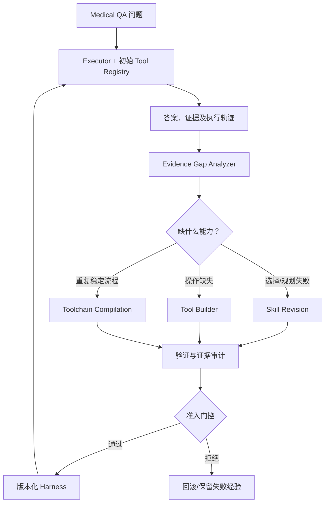

# MedToolEvo：面向循证医学问答的 Agent 自进化与工具学习研究方案

> **版本**：v0.1（2026-10-28）  
> **状态**：研究提案 / 待实证验证；本文所述模块、指标和实验结果预期均不代表已完成实验。  
> **任务范围**：以**文本型、文献证据驱动的 Biomedical / Medical QA**为主；不直接面向临床自动决策。

## 0. 一页摘要

**核心设想**：让 Medical QA Agent 不仅调用现成检索工具，还能从失败轨迹中识别缺失的**证据处理能力**，自动编写或修复可执行工具，通过独立测试与风险门控决定是否注册，并在未见过的医学问题中复用。

建议工作名称：

- **MedToolEvo** — *Evidence-Gap-Driven Self-Evolving Tools for Biomedical Question Answering*
- 可选题目：*From Evidence Gaps to Reusable Tools: Self-Evolving Agents for Biomedical QA*

**优先路线**：能力缺口识别（ReSight）＋ Skill/Tool/Toolchain 协同进化（ChartEvo）＋ 程序化工具创造（DKGI）＋ 成对验证与保守准入（SAGE）。这些是研究灵感来源，并非直接复现后即可构成创新。

**推荐第一版数据**：BioASQ 14b 为主；DocHop-QA 压测跨文档/表格工具；BioHopR 测结构化关系泛化。**推荐第一版模型**：QA Agent 采用 Qwen3.5-9B 或 27B；Tool Builder 采用 Qwen3-Coder-30B-A3B-Instruct；检索为 BM25＋Qwen3 Embedding/Reranker。第一阶段冻结全部模型权重。

**最重要的研究假设**：

> 对于医学文献 QA，可以用受控的证据和操作干预区分“检索缺口、提取缺口、计算缺口、整合缺口、推理缺口”；依据该诊断产生的工具，比仅对失败答案进行笼统反思，更有跨题复用价值。

---

## 1. 研究背景、定位与边界

### 1.1 为什么是 Medical QA？

医学文献 QA 往往同时涉及：

1. **跨来源检索**：相关结论分散在多篇论文中；
2. **证据处理**：抽取表格、统一术语、比较研究对象和结局；
3. **可执行计算**：风险比、比例、置信区间或单位换算等；
4. **证据审计**：来源能否真正支持回答，是否相互冲突或已经过时；
5. **合理不确定性**：信息不足时保留不确定性，而非生成貌似完整的结论。

常规 RAG 偏重找文档；固定工具 Agent 偏重选择工具。本文拟研究的问题是：**工具集本身能否随着任务需求而增长，而且增长是否可验证、可迁移？**

### 1.2 已有工作与差异化要求

| 工作                                                                        | 已有贡献                             | 本项目应避免的简单重复               |
| ------------------------------------------------------------------------- | -------------------------------- | ------------------------- |
| [ChartEvo (2026)](https://arxiv.org/abs/2610.28282)                       | 联合进化 Skill、可执行 Tool 和本地工具链 SELT  | 只把 Chart QA 换成 Medical QA |
| [DKGI (2026)](https://arxiv.org/abs/2610.18616)                           | Agent 在图文件上编写 Python，工具创建与使用共同演化 | 只让 Agent 编写知识图谱查询         |
| [ReSight (2026)](https://arxiv.org/abs/2610.33487)                        | 从执行和探索轨迹识别能力缺口，沉淀可复用工具/记忆        | 只把故障记录转成提示词               |
| [SAGE (2026)](https://arxiv.org/abs/2609.36043)                           | 成对逐题比较、统计准入以限制性能回退               | 只用平均准确率判断工具是否应保留          |
| [Skill∞ (2026)](https://arxiv.org/abs/2610.35434)                         | 优化任务 Skill 的 Meta-Skill 也可递归自优化  | 第一版同时做所有层级进化，导致实验不可控      |
| [HMED (2026)](https://arxiv.org/abs/2610.07979)                           | 从相同初始状态比较 Meta-Skill 修订前后的效果     | 把相关性误当作策略更新的因果收益          |
| [SSE-Bio (EMNLP 2026)](https://aclanthology.org/2026.findings-emnlp.497/) | 生物医学多跳 QA 中的结构化记忆与检索策略进化         | 仅更新检索模板或策略                |
| [MedRSI (2026)](https://arxiv.org/abs/2609.24838)                         | 医疗诊断失败驱动工具创造、临床代价感知及慢注册          | 声称“首次医疗自进化工具创造”           |
| [SEMA-RAG (2026)](https://arxiv.org/abs/2605.17101)                       | 多 Agent 的自进化医学检索与证据裁决            | 只堆叠多个检索 Agent             |

**建议的技术差异**：

- **Gap Localization**：提出更可检验的医学证据操作缺口识别，而非仅使用 LLM 反思；
- **Typed Evidence Tools**：候选工具需要明确输入/输出类型、证据出处、失败条件；
- **Counterfactual Reuse Evaluation**：验证工具能否跨疾病、跨证据形式帮助其他问题；
- **Evidence-Aware Admission**：除答案正确率外，显式评估支持证据、回退和代价。

这些是拟研究的贡献，需要通过对照实验确认，而非预先成立的事实。

---

## 2. 数据集和数据类型

### 2.1 优先级

**首选数据类型**：开放式、跨文档、有文献 ID 和支持片段的医学文献问答。最好加入表格与结构化关系，以产生真实的工具需求。

| 数据集                                                                                            | 公开规模/结构                                                                          | 用途                         | 注意事项                                            |
| ---------------------------------------------------------------------------------------------- | -------------------------------------------------------------------------------- | -------------------------- | ----------------------------------------------- |
| **[BioASQ 14b](https://participants-area.bioasq.org/datasets/)**                               | 2026 年训练集 **5,729** 道；专家标注相关 PubMed 文献、片段、exact/ideal answers；官方新增测试问题 **280** 道 | **主开发/主评测**：证据定位与开放问答      | 官方下载需注册；注意历史挑战测试题会被并入后续训练版本                     |
| **[DocHop-QA](https://huggingface.co/datasets/anonymousaaai123/DocHopQA_Dataset)**             | **11,379** 道，其中段落型 8,547、表格型 2,812；含 PMC ID、context、text/table、fan/chain 标签      | **复杂工具任务**：跨文档、表格提取、计算     | 数据卡未明确列出统一 gold answer 字段，需先核对评测脚本；其领域并非全部为临床问题 |
| **[BioHopR](https://huggingface.co/datasets/knowlab-research/BioHopR)**                        | 约 **7,633** 道，PrimeKG 一跳/两跳、多答案                                                  | **结构化工具泛化**：医学实体关系查询       | SSE-Bio 已经使用，不能作为唯一主任务                          |
| **[MedHopQA](https://academic.oup.com/database/article/doi/10.1093/database/baag057/8796013)** | **1,000** 道专家验证的疾病主题多跳问题                                                         | 独立、自由文本多跳 QA 评测            | 核心材料为 Wikipedia 疾病主题页面，临床证据真实性要求有限              |
| **[MedAESQA](https://pmc.ncbi.nlm.nih.gov/articles/PMC12179289/)**                             | **40** 个主问题，每题多个人工/模型回答、人工证据支持判断                                                 | 小规模**证据忠实度**审计             | 样本少，不适合作为主训练集                                   |
| **[EHRNote-ChatQA](https://www.physionet.org/content/ehrnote-chatqa/1.0.0/)**                  | **967** 个患者级样本、**16,072** 道内容与证据问题                                               | 二期探索纵向病历时间线 Tool Evolution | 需要 PhysioNet 资质、培训及 DUA；不应直接用于不合规的外部 API        |
| **MedQA / MedMCQA**                                                                            | 医学考试选择题                                                                          | 附加 smoke test              | 缺少明确工具需求和逐条证据链；不宜作为核心发现集                        |

### 2.2 第一版数据策略

- **主研究任务**：BioASQ 14b；
- **工具演化压力测试**：DocHop-QA 的段落型与表格型子任务；
- **可选外部验证**：BioHopR 或 MedHopQA；
- **证据忠实度专项测试**：MedAESQA；
- **二期扩展**：若研究临床长期记忆，可转向 EHRNote-ChatQA。

在正式使用前，核验每份数据的许可证、题目/答案可访问性、标注质量和原始文献许可范围。

### 2.3 自建数据所需字段

每道研究任务建议组织为：

```json
{
  "id": "qa_0001",
  "question": "...",
  "gold_answer": "...",
  "gold_evidence": [
    {
      "source_id": "PMID_or_PMCID",
      "section": "Results",
      "location": "paragraph_or_table_id",
      "text": "...",
      "evidence_type": "text_or_table"
    }
  ],
  "reasoning_tags": [
    "multi_hop",
    "cross_document",
    "numeric"
  ],
  "source_date": "YYYY-MM-DD",
  "split": "discovery"
}
```

其中 **gold_answer、gold_evidence、reasoning_tags 是离线标注**。不得在最终测试时把这些字段交给解题 Agent。若原数据无金标准答案/位置，不得假装有，应采用独立核验或排除相应自动评测指标。

---

## 3. 模型与系统组件

| 角色                              | 推荐配置                                                                                                                   | 职责                       | 是否需要训练        |
| ------------------------------- | ---------------------------------------------------------------------------------------------------------------------- | ------------------------ | ------------- |
| **QA Executor**                 | [Qwen3.5-9B](https://huggingface.co/Qwen/Qwen3.5-9B)（MVP）；[Qwen3.5-27B](https://huggingface.co/Qwen/Qwen3.5-27B)（正式评测） | 问题理解、工具选择、证据整合、答复        | 初期否           |
| **Tool Builder / Coding Agent** | [Qwen3-Coder-30B-A3B-Instruct](https://huggingface.co/Qwen/Qwen3-Coder-30B-A3B-Instruct)                               | 编写/修复 Python 工具、组织工具链与测试 | 初期否           |
| **Gap Analyzer**                | 可先复用 QA 模型＋程序化观测                                                                                                       | 区分检索、提取、计算、整合、推理瓶颈       | 初期否           |
| **Evidence Verifier**           | 金标准对比、确定性程序、必要时 LLM/NLI 辅助                                                                                             | 判断证据是否支持结论、是否存在不安全回退     | 初期否           |
| **Dense Retriever**             | [Qwen3-Embedding-0.6B](https://huggingface.co/Qwen/Qwen3-Embedding-0.6B)                                               | 检索 PubMed/PMC 证据         | 初期否           |
| **Reranker**                    | [Qwen3-Reranker-0.6B](https://huggingface.co/Qwen/Qwen3-Reranker-0.6B)                                                 | 精排候选段落                   | 初期否           |
| **医疗专用对照**                      | [MedGemma-27B-Text-IT](https://huggingface.co/google/medgemma-27b-text-it)                                             | 检测对医学专用 Backbone 的迁移性    | 可选；先核验工具接口与许可 |

**基础非模型组件**：BM25、PubMed API/本地许可语料库、PMC XML/表格解析、Python 计算库、版本化 Tool Registry、隔离执行环境、日志与指标存储。

硬件规划：

- **24GB GPU**：优先量化 9B Executor；Builder 可通过 API 或分时运行量化模型。
- **48GB GPU**：更适合 27B Executor 或 30B MoE Builder 分时执行。
- **多卡 80GB 级**：可以更灵活地跑大模型和长上下文。
- 上述为规划建议；实际显存取决于量化、KV Cache、上下文、并发。30B-A3B 的 **3B active** 不代表只需加载 3B 参数权重。

**论文比较原则**：固定 Executor 权重、温度、上下文预算、工具调用上限和数据划分；单独记录 Builder 的离线模型成本。不要用不同强度的 Builder 让方法比较失去公平性。

---

## 4. 方法总览



设基础模型为固定的 **M**，Agent 运行环境为 **H_t = (S_t, T_t, C_t)**：

- **S_t：Skills**，描述何时检索、何时调用工具、如何处理证据；
- **T_t：Tools**，具有可执行代码、接口契约、证据来源输出的原子工具；
- **C_t：Toolchains**，由多个经过验证的工具构成的稳定依赖图。

系统执行、诊断、生成候选更新、验证并注册，得到下一个环境 H\_(t+1)。**自进化的主要对象是 Harness，而非基础模型权重。**

### 4.1 初始工具集 T0

建议先从少量通用原语开始，避免人工预先实现所有“新工具”：

1. search_pubmed(query)：关键词检索；
2. semantic_retrieve(query)：语义检索；
3. retrieve_article(source_id)：读取许可允许的文章或片段；
4. extract_section(source, section)：获取论文部分内容；
5. python_compute(expression/data)：受限制的数值运算；
6. entity_lookup(entity)：医学术语标准化；
7. verify_source(source_id/location)：核验证据位置。

**区别**：预置工具提供基础获取/计算能力；待发现的新工具应体现稳定的、跨问题有意义的操作，如跨研究指标统一、表格结构提取、实体桥接和证据冲突审计。

### 4.2 Evidence Gap Analyzer：区分失败原因

建立如下失败类型：

| 代码 | 失败类型               | 判断依据（训练/开发阶段）                     | 推荐更新                        |
| -- | ------------------ | --------------------------------- | --------------------------- |
| R  | Retrieval          | 缺失 gold supporting snippets 或关键文献 | 检索 Skill/查询策略               |
| E  | Extraction         | 有正确文献，未正确提取表格/字段                  | 新增或修复 extraction Tool       |
| C  | Computation        | 证据数据正确，数学/统计操作失败                  | 新增/修复 computation Tool      |
| I  | Integration        | 多证据都找到，但关联、冲突整合失败                 | comparison Tool 或 Toolchain |
| P  | Planning/Reasoning | 必要证据及操作结果已有，推理仍错误                 | 推理 Skill                    |
| F  | Faithfulness       | 最终答案看似正确，但引用未支持事实                 | 证据审计 Tool/拒答规则              |

**关键创新方案：受控反事实干预**。对同一训练/开发问题执行：

- **A：End-to-end**，Agent 自主检索、操作、回答；
- **B：Gold Evidence**，提供正确证据，测是否排除检索瓶颈；
- **C：Gold Structured Facts**，另提供人工/程序核验的结构化结果，测提取瓶颈；
- **D：Gold Operation Outputs**，提供已验证的必要计算/关系结果，测计算与整合瓶颈。

例：A 错 B 对，说明检索是重要瓶颈；B 错 C 对，说明提取是重要瓶颈。但现实中会有**多个同时存在的失败原因**，上述模式只能形成操作性诊断，需重复实验、抽样人工评估和更精细的多标签机制，不能当成绝对因果真值。

**测试阶段不注入 gold 信息**；模型只能根据检索结果、执行轨迹、证据覆盖和失败信号作判断。

### 4.3 Candidate Tool Generation

Builder 的输入包括：

- 问题和允许访问的原始证据；
- 基础 Agent 的执行轨迹；
- 缺口类型及支持它的实验信号；
- 现有工具接口；
- 受限的可用 Python 库和工具白名单。

Builder 输出：

- Python 函数或工具链；
- 输入输出 JSON Schema；
- 适用范围及不适用条件；
- 单元测试/边界测试；
- 证据出处与错误信息；
- 版本号及依赖关系。

**示例：**

```python
def normalize_study_result(study):
    """
    Input:
        Study metadata and extracted numeric outcomes.
    Output:
        {
          "normalized_measure": ...,
          "unit": ...,
          "population": ...,
          "source": {"pmid": ..., "section": ..., "table_id": ...},
          "warnings": [...]
        }
    """
    ...
```

工具不得返回凭空生成的 PMID、不可追踪的研究数值或未验证的治疗建议。计算工具的公式、边界条件、单位转换必须由确定性测试覆盖。

### 4.4 Typed Evidence Contract：医学特色

每个工具除传统 API Schema 外，还需提供：

- **证据输入类型**：文本、表格、关系三元组、数值；
- **证据来源**：PMID/PMCID、片段位置/表格编号；
- **结果语义**：提取值、关系、比较结果、置信或不确定性；
- **适用条件**：研究人群、指标定义、单位等；
- **拒绝条件**：缺值、单位不兼容、无法确认方向、证据冲突；
- **可追溯链路**：具体输出如何由哪些原始字段计算得到。

如此工具的质量可从**可执行性 + 任务准确性 + 来源支持性**三个维度评价。

### 4.5 Toolchain Evolution

高频、稳定的调用序列可以固化为有依赖关系的工具链，例如：

```text
retrieve_article
      ↓
extract_study_table
      ↓
normalize_study_result
      ↓
compare_effect_sizes
      ↓
audit_source_support
```

仅当跨题执行路径稳定、接口明确且测试通过时，才封装成可复用工具链；不要把每道题的临时思路都存为 Skill，避免记忆污染和工具库膨胀。

### 4.6 Verification / Admission

候选工具至少接受四类检查：

1. **功能测试**：代码安全、格式合法、正常/异常输入可用；
2. **当前问题复测**：是否修复导致其被提出的失败；
3. **独立迁移测试**：其他疾病、其他论文、其他数据结构是否受益；
4. **性能回退测试**：已解决问题是否被新工具破坏。

可定义研究效用：

**U(T) = ΔQA + α·ΔEvidence + β·Transfer − γ·Cost − δ·Regression**

这里是**拟议目标**，并非直接沿用某篇论文的公式。建议使用成对逐题比较、bootstrap 置信区间或预注册的一侧检验，并对严重医学错误施加不可用平均收益抵消的硬性门槛。参考 SAGE 的保守准入思想。

**强制限制**：生成代码在隔离沙箱执行，资源受限，默认只读，禁用任意网络访问、文件写入和非白名单依赖；对外仅暴露经过验证的 API。

---

## 5. 数据驱动的进化循环（伪代码）

```python
harness = initialize_harness(base_tools, base_skills)

for task in discovery_tasks:
    answer, evidence, trace = executor.run(task.question, harness)

    # gold supervision is used only in offline discovery/development.
    failure = evaluate_offline(answer, evidence, task.gold)
    if not failure.requires_investigation:
        continue

    gap = diagnose_gap(
        trace=trace,
        retrieved=evidence,
        counterfactual_signals=run_dev_interventions(task)
    )

    candidate = proposer.propose(
        gap=gap,
        trace=trace,
        current_harness=harness
    )

    checks = [
        executable_tests(candidate),
        evidence_contract_tests(candidate),
        cross_task_transfer_tests(candidate, independent_dev_cases),
        paired_regression_tests(candidate, harness, regression_cases),
    ]

    if statistical_and_safety_gate(checks):
        harness = register_versioned_component(harness, candidate)
    else:
        archive_failed_proposal(candidate, checks)

freeze(harness)
evaluate_on_untouched_test_sets(harness)
```


**防信息泄漏要求**：

- 每条发现任务的 gold 答案只能在离线评估环节出现；
- Builder 不能把答案字面量写入函数；
- 不同测试域须按问题、论文、患者（如有）、疾病/关系类型等去重；
- 最终测试阶段冻结 Harness，不使用测试 gold 更新工具；
- 若需要在线无监督进化，应另设明确协议，不能与冻结评测混在一起。

---

## 6. 核心评测任务与指标

### 6.1 两种互补评测环境

**Setting 1：Oracle Evidence**

提供 gold 文献/片段，屏蔽检索误差，专门考察证据提取、表格计算、跨文档比较及工具构建。这可帮助确认“工具是否真正提供了缺失操作”。

**Setting 2：End-to-end Retrieval**

只给问题，让 Agent 在固定版本的可用语料中检索和回答，考察最终系统效用。BioASQ 的检索/回答多阶段任务适合这一设计。

这两种设置都需要，否则整体 QA 分数提升无法清晰归因。

### 6.2 指标

| 维度                 | 建议指标                                                                   |
| ------------------ | ---------------------------------------------------------------------- |
| QA 效果              | Exact Match、F1、专家/人工核验的开放答案正确率                                         |
| Retrieval          | Recall@k、MRR 或相关证据命中率                                                  |
| Evidence Grounding | Gold snippet overlap、citation support precision、unsupported claim rate |
| Tool 能力            | 工具创建成功率、测试通过率、独立任务复用率                                                  |
| 迁移性                | 未见疾病/关系/表格结构的性能增益                                                      |
| 稳定性                | 已解决题目回退率、严重错误率                                                         |
| 效率                 | LLM tokens、模型调用、工具调用、平均延迟及离线 Builder 成本                                |
| 质量控制               | 拒答准确性、无法比较情况识别、证据冲突检测                                                  |

### 6.3 核心 Baselines

1. Base LLM，无检索；
2. LLM＋RAG；
3. Fixed-Tool Agent；
4. Skill Evolution Only；
5. Tool Evolution Only；
6. Skill＋Tool＋Toolchain Evolution；
7. **完整方案**：再加入反事实 Gap Analysis、Evidence Contract、Risk-aware Gate；
8. 相关实现可行时，复现/改造 SSE-Bio、MedRSI 做额外对照。

**严格公平性**：相同 Backbone、相同推理预算、相同语料和工具原语。独立报告进化阶段额外开销，不可只比较运行时成本。

### 6.4 必要消融

- 去掉 Gap Analyzer，仅靠 LLM 反思；
- 用一次性工具生成取代持续修复与复用；
- 去掉 Toolchain，仅运行 ReAct；
- 去掉 Evidence Contract，仅验证代码能运行；
- 去掉统计准入，仅按平均准确率录取；
- 固定相同 Token/工具调用预算，比较“创造工具”与“增加搜索/思考次数”。

**最核心的论文证据**：工具在创造它的题之外，显著提升**未见过的问题**；有独立支持证据；回退可控。

---

## 7. 自建数据与训练/测试划分

第一轮建议：

| 阶段          |                        规模建议 | 目的                |
| ----------- | --------------------------: | ----------------- |
| Baseline 跑题 |                500–800 道开发题 | 测定失败类型分布          |
| 候选工具触发      |         从上述失败例中选约 100–200 例 | 观察真实缺口与工具创造       |
| 工具准入验证      |     200–300 道未用于提出该工具的独立开发题 | 工具跨题复用与回退         |
| 最终主测试       |                 官方封存测试/独立新题 | 冻结 Harness 后的实际效果 |
| 外部泛化        | DocHop-QA、BioHopR 可用且经核验的子集 | 跨证据类型与任务迁移        |

以上数量仅为**MVP 建议**，不是数据集官方固定划分。不能从公开总体规模中直接扣减、拼接成互斥集合而忽略同源文献和问题重叠。

人工建议审核：

- 失败类型：随机/分层抽样核对；
- 工具输出：高风险、数值和引用样本优先；
- 跨题复用：确保不是同一证据的改写题；
- 预注册停止标准，例如“多数工具只解决原题而无法迁移”则暂缓完整进化实验。

---

## 8. 实施路线与里程碑

### M0：数据审计（第 1 周）

- 下载或经授权访问 BioASQ；
- 检查 DocHop-QA 实际字段、答案与评测脚本；
- 构建去重、来源和许可证审计；
- 确定冻结语料版本及固定测试集合。

**交付物**：可复现数据读取脚本、数据卡、评测器。

### M1：固定工具基线（第 2 周）

- 部署 Qwen3.5-9B；
- 建 BM25、Embedding、Reranker；
- 接入 PubMed 和基础计算工具；
- 输出答案、证据片段和完整轨迹。

**交付物**：RAG / Fixed-Tool baseline，失败类型初步分布。

### M2：Gap 反事实诊断（第 3 周）

- A/B/C/D 受控干预；
- 基于 gold evidence 生成开发阶段标签；
- 小规模人工抽检；
- 确定值得创建工具的 2–3 类高频缺口。

**停止条件**：如果缺口诊断无法稳定复现，先改进标签体系，不应立刻扩展复杂自进化循环。

### M3：工具生成与保守注册（第 4–5 周）

- 集成 Qwen3-Coder；
- 工具 Typed Contract、单元测试和隔离运行；
- 建立工具版本/回退机制；
- 做独立题目迁移和成对准入。

**交付物**：3–5 类可复用工具原型、注册日志、性能曲线。

### M4：完整评测（第 6 周及以后）

- 正式两个模型规模；
- BioASQ 主评测、DocHop 专项评测；
- 消融、工具使用效率、跨疾病泛化；
- 错误分析和消极结果记录。

**交付物**：可写论文的方法与实验图表，或明确的可行性结论。

---

## 9. 风险与对策

| 风险                       | 对策                                          |
| ------------------------ | ------------------------------------------- |
| 已有 MedRSI 做过医疗工具创造       | 不声称 first；聚焦反事实证据缺口诊断及跨文献工具可验证迁移            |
| 模型直接记住 BioASQ 答案         | 新题/时间划分、跨文献去重、固定语料、独立来源复核                   |
| DocHop-QA 答案字段或质量不满足自动奖励 | 先审计字段与评测脚本，必要时只作为操作能力专项数据并人工核验              |
| LLM 自评形成循环论证             | 使用 gold evidence、可执行单元测试、程序计算及人工抽查          |
| 新工具只是将答案写死               | 使用不同疾病/文献上的 transfer test，代码查重和数据依赖检查       |
| 工具越多性能越低                 | 准入门控、路由与工具库稀疏化、过期工具回滚                       |
| 医学错误不可接受                 | 特别标记严重错误；证据不足时输出不确定或拒答                      |
| 生成 Python 有安全风险          | 仅允许隔离、只读、受限资源、白名单执行                         |
| 涉及敏感 EHR 数据              | 第一阶段不用受限 EHR；需要时遵守 PhysioNet DUA 和模型提供商数据政策 |
| 外部文献会更新                  | 固定语料快照、记录检索时间与来源版本                          |

---

## 10. 最小研究主张与决策点

### 最小可行主张

> 与固定工具或仅做 Prompt/Skill 修订的 Agent 相比，基于证据操作缺口生成并验证的新工具，在固定 Backbone 和公平预算下，能够提升 Biomedical QA 的证据定位/处理准确性，且效果可迁移到未参与工具创造的文献与问题。

### 建议先回答的三个问题

1. **可识别吗？** 反事实证据干预能否稳定区分检索与工具操作瓶颈？
2. **可创造吗？** Builder 能否构造比通用工具更可靠、可执行的新操作？
3. **可迁移吗？** 工具是否在新疾病、新论文或新表格上仍然有效？

如果其中任一环节不成立，就调整研究目标；不要通过反复查看测试结果来“优化”进化机制。

### 尚需项目组确认

- 实验硬件：单张 24GB、48GB、A100/H100 多卡，或 API？
- 核心贡献：偏 **Tool Creation** 还是偏 **Gap Diagnosis**？
- 是否具备医学专家抽样审查资源？
- 目标投稿周期与所需复现级别？

---

## 11. 主要参考资料与入口

### 自进化与工具学习

1. ChartEvo (2026), <https://arxiv.org/abs/2610.28282>
2. ReSight (2026), <https://arxiv.org/abs/2610.33487>
3. DKGI / Knowledge Graphs as Files (2026), <https://arxiv.org/abs/2610.18616>
4. SAGE (2026), <https://arxiv.org/abs/2609.36043>
5. Skill∞ (2026), <https://arxiv.org/abs/2610.35434>
6. HMED (2026), <https://arxiv.org/abs/2610.07979>
7. SSE-Bio (EMNLP 2026), <https://aclanthology.org/2026.findings-emnlp.497/>
8. MedRSI (2026), <https://arxiv.org/abs/2609.24838> ; <https://github.com/ImprintLab/MedRSI>
9. SEMA-RAG (2026), <https://arxiv.org/abs/2605.17101>

### 数据集

1. BioASQ 14b 官方数据, <https://participants-area.bioasq.org/datasets/>
2. BioASQ 2026 任务说明/统计, <https://ceur-ws.org/Vol-4283/paper1.pdf>
3. DocHop-QA (EMNLP 2026), <https://aclanthology.org/2026.emnlp-main.2563/>
4. DocHop-QA 数据卡, <https://huggingface.co/datasets/anonymousaaai123/DocHopQA_Dataset>
5. BioHopR, <https://huggingface.co/datasets/knowlab-research/BioHopR>
6. MedHopQA, <https://academic.oup.com/database/article/doi/10.1093/database/baag057/8796013>
7. MedAESQA, <https://pmc.ncbi.nlm.nih.gov/articles/PMC12179289/>
8. EHRNote-ChatQA, <https://www.physionet.org/content/ehrnote-chatqa/1.0.0/>

### 模型

1. Qwen3.5-9B, <https://huggingface.co/Qwen/Qwen3.5-9B>
2. Qwen3.5-27B, <https://huggingface.co/Qwen/Qwen3.5-27B>
3. Qwen3-Coder-30B-A3B-Instruct, <https://huggingface.co/Qwen/Qwen3-Coder-30B-A3B-Instruct>
4. Qwen3 Embedding, <https://huggingface.co/Qwen/Qwen3-Embedding-0.6B>
5. Qwen3 Reranker, <https://huggingface.co/Qwen/Qwen3-Reranker-0.6B>
6. MedGemma 27B, <https://huggingface.co/google/medgemma-27b-text-it>

---

**结论**：先用 **BioASQ + Qwen3.5-9B + 固定基础工具**，验证“反事实证据缺口识别”是否能帮助 Tool Builder 产生真正可迁移的医学证据处理工具。成功后再扩展到 27B Backbone、DocHop 表格工具和 Skill/Toolchain 协同进化。
