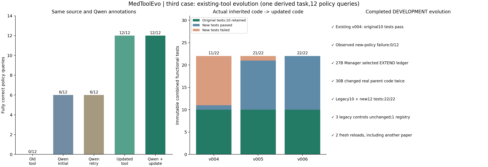

# 第三条闭环：已有证据台账的工具自进化

开发级完整验收通过，时间：北京时间2026-11-09 20:23:01。Qwen3.5-27B负责标注、Executor、Manager、契约和审核；Qwen3-Coder-30B负责实际代码扩展和修复。没有训练模型权重，没有人工修改候选函数。

## 本次证明了什么

沿用此前已经存在、原10项测试通过的evidence_ledger v004。面对新的关系合取、析取、显式正负事实、排除及证据作用范围要求，旧工具只返回并集，实际12个查询0/12；Manager自主选择extend现有台账，Builder从真实父代码更新到v006，原10项回归一直保留，通过新旧22项测试后完成实际调用、开发注册和跨论文重载复用。

旧工具在原契约上正确；0/12反映新查询超出旧能力，不等于旧任务失败。父代码、旧测试及原注册文件均未改动，新版登记在本案例独立开发库。此处12个是同一个派生工程任务的条件索引请求，不是12道独立医学题，也不是BioASQ F1。

## 前后结果

| 执行方式 | 完整查询通过 | 结果集合正确 |
|---|---:|---:|
| 原工具实际调用 | 0/12 | 0/12 |
| Qwen初始回答（同一标注＋旧工具观察） | 6/12 | 7/12 |
| Qwen同证据重试 | 6/12 | 7/12 |
| 更新工具实际调用 | 12/12 | 12/12 |
| Qwen读取更新工具输出 | 12/12 | 12/12 |

完整通过同时要求筛选结果、证据ID及顺序正确。初始5个查询的成员有误，另1个为证据记录错误；不是仅靠名称换写改善。所有组使用同一份Qwen源关系标注，未给工具组单独补充医学事实。该单例、单一配置结果不构成总体统计收益或临床正确性证明。

## 真正的版本继承与回归

| 实际版本 | 原10项回归 | 新12项测试通过 | 组合测试 |
|---|---:|---:|---:|
| v004 | 10/10 | 1/12 | 11/22 |
| v005 | 10/10 | 11/12 | 21/22 |
| v006 | 10/10 | 12/12 | 22/22 |

初始v004副本的代码SHA与既有父版本完全一致，并非人为制造的坏版本。v005完成主要扩展后还把仅有unknown事实的对象错误纳入“只排除某关系”的查询，独立测试拦截。第二次自动更新v006修复此问题。组合测试在首次代码更新前冻结，整个过程没有删改失败测试。

父代码SHA256：75b7c64645d3557e15ccd24db903939c1429e2027d8589ddefc818b2570a0a9f。

新版代码SHA256：0b75e1050a1af7ddb83f2639a77635a5ec4f00bb7dd4cf5bda716f2d71d8b679。

原10项测试SHA256：f8dccce35eb81b26198eb8b851e0e1051e68056b426efa795ffd17d575f56d1f。新组合测试SHA256：83eb5215f8d217cb1c19fd7b503e0e6a316ee2d2c4a649c483dec5c13334cdf8。

## 全流程核查

- 源关系标注：主文献13组、复用文献7组，均由27B实际标注并通过预设源标注核验。
- 真实失败：旧代码在12个新policy输入上均不符合查询，全部实际调用输入/输出保留；27B自行重算和重试均6/12。
- 更新对象：Manager选择extend，target=evidence_ledger；不是重建一个无继承关系的工具。
- 测试：原10个具名测试定义和辅助逻辑保留；新增10个预设边界输入＋2个Qwen设计输入，期望值由独立规则计算，代码更新前固定，共22项。
- 真实代码更新：从父v004出发，两次30B自动更新；无人工源码补丁，完整请求和诊断反馈保留。
- 源任务修复：实际新版调用12/12；27B使用真实结果后12/12，源关系及旧能力审核通过。
- 旧能力控制：三个原文子集在无policy的旧接口上，新旧版本输出逐项相同。
- 开发注册：1件更新工具，保留parent_manifest、parent_version和parent_sha256；正式稳定注册0。
- 新进程复用：第一回合重载原任务中的两个查询组成的新批次，不能称为未见查询；第二回合在另一论文上运行两个新查询，代码保持不变，均通过。复用由控制器触发，不代表已验证开放式自主工具路由。

## 来源、构造与人工介入

主来源为DocHopQA条目9400附带的PMC11837447正文：[Accuracy of artificial intelligence in detecting tumor bone metastases: a systematic review and meta-analysis](https://pmc.ncbi.nlm.nih.gov/articles/PMC11837447/)。复用来源为条目9532、PMC11856201：[Efficacy and Safety of Celecoxib and a Korean SYSADOA (JOINS) for the Treatment of Knee Osteoarthritis: A Systematic Review and Meta-Analysis](https://pmc.ncbi.nlm.nih.gov/articles/PMC11856201/)。

源XML原样保留。引用分组及区间展开是可信机械预处理；关系语义由Qwen标注，所有对照共享。研究者预先选择来源、定义关系词表、12个查询、规则与预设标签核验、独立参考程序及验收；这些人工介入已记录，不把本例称作原DocHopQA问题或开放域自主科学发现。Builder收到通用契约、实际父代码及虚构测试反馈，没有收到真实研究ID或参考查询结果。

查询只描述当前段落的引用索引：none_of表示排除存在某显式标注的对象，不证明某研究没有实施某操作；缺失不等于负事实。原文计数与字面引用区间可能不一致，本例不替作者纠正科学结论，也不把某引用出现当作临床证据充分。

| 查询 | 参考结果（源引用ID） | 初始Qwen完整通过 | 同标注重试 | 更新后 |
|---|---|---|---|---|
| q1 | CR37, CR51 | 是 | 是 | 是 |
| q2 | CR49, CR50 | 否 | 否 | 是 |
| q3 | CR39, CR40, CR46, CR53, CR56 | 否 | 否 | 是 |
| q4 | CR18, CR43, CR44, CR45 | 否 | 否 | 是 |
| q5 | CR39, CR46, CR53 | 是 | 是 | 是 |
| q6 | CR20, CR37, CR42 | 否 | 否 | 是 |
| q7 | CR37, CR50 | 是 | 是 | 是 |
| q8 | CR45 | 是 | 是 | 是 |
| q9 | CR18, CR40, CR43, CR44, CR45 | 否 | 否 | 是 |
| q10 | CR20, CR42 | 是 | 是 | 是 |
| q11 | 空集 | 是 | 是 | 是 |
| q12 | CR37, CR51 | 否 | 否 | 是 |

## 可复核原始文件

- [最终验收](evidence/runs/engineering_policy_case_20261109T121042/case_acceptance.json)
- [Manager选择更新对象](evidence/runs/engineering_policy_case_20261109T121042/manager.json)
- [父版本与代码继承记录](evidence/runs/engineering_policy_case_20261109T121042/builds/candidate/lineage.json)
- [全部版本、测试及真实修复](evidence/runs/engineering_policy_case_20261109T121042/builds/candidate/builder_summary.json)
- [原始旧10项测试](evidence/runs/engineering_policy_case_20261109T121042/builds/candidate/legacy_original_tests.py)
- [完整22项组合测试](evidence/runs/engineering_policy_case_20261109T121042/builds/candidate/independent_tests.py)
- [实际更新代码](evidence/tools/validated/evolved_add_policy_filter_engine_00a5aa6c_v006.py)
- [前后结果和审核](evidence/runs/engineering_policy_case_20261109T121042/original_repair.json)
- [控制结果](evidence/runs/engineering_policy_case_20261109T121042/controls.json)
- [注册清单](evidence/runs/engineering_policy_case_20261109T121042/development_registry/evidence_ledger.json)
- [重载复用](evidence/runs/engineering_policy_case_20261109T121042/reuse.json)
- [源数据和构造方式](evidence/runs/engineering_policy_case_20261109T121042/task.json)

此前两条案例的已知问题继续保留，第三条通过不代表字符定位工具的残余缺陷已修复。三条案例仍为开发工程演示，均不替代原100题验收、不计入1130题正式结果；当前没有因此启动全量。
